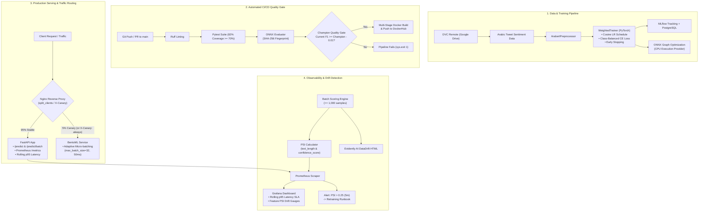

# 🌐 Production MLOps: Arabic Sentiment Analysis Pipeline & Serving

[](pyproject.toml)
[](src/arabic_sentiment/api/main.py)
[](src/arabic_sentiment/serving/service.py)
[](models/arabert-twitter-onnx/)
[](docker/Dockerfile)
[](tests/)
[](pyproject.toml)
[](docker/prometheus/prometheus.yml)
[](docker/grafana/dashboard.json)
[](src/arabic_sentiment/monitoring/drift.py)

A production-grade, end-to-end MLOps system for real-time and batch **Arabic Sentiment Analysis** (`positive`, `neutral`, `negative`). The system fine-tunes **Twitter-AraBERT** (`aubmindlab/bert-base-arabertv02-twitter`) with Arabic morphological preprocessing, exports the model to an optimized **ONNX** runtime graph for ultra-low latency CPU inference, and packages the complete lifecycle: **DVC** data versioning, **MLflow** tracking, **GitHub Actions** CI/CD with automated **Champion-Challenger Quality Gates**, dual serving engines (**FastAPI** & **BentoML** adaptive micro-batching), **Nginx Canary traffic splitting (95/5)**, and full observability with **Prometheus**, **Grafana**, and **Evidently AI** drift monitoring.

---

## 📑 Table of Contents

- [Key Architecture & Capabilities](#key-architecture--capabilities)
- [Model Performance & Benchmarks](#model-performance--benchmarks)
- [Repository Structure](#repository-structure)
- [Quickstart: Zero to Prediction](#quickstart-zero-to-prediction)
  - [Option 1: Docker Container (Fastest)](#option-1-docker-container-fastest)
  - [Option 2: Full MLOps Stack via Docker Compose](#option-2-full-mlops-stack-via-docker-compose)
  - [Option 3: Local Development with uv](#option-3-local-development-with-uv)
- [End-to-End MLOps Pipeline](#end-to-end-mlops-pipeline)
  - [1. Data & Artifact Versioning (DVC)](#1-data--artifact-versioning-dvc)
  - [2. Model Training with Class-Balanced Weights](#2-model-training-with-class-balanced-weights)
  - [3. Experiment Tracking (MLflow)](#3-experiment-tracking-mlflow)
  - [4. ONNX Graph Optimization & Export](#4-onnx-graph-optimization--export)
  - [5. Test Split Evaluation & Artifact Fingerprinting](#5-test-split-evaluation--artifact-fingerprinting)
  - [6. DVC Pipeline Execution](#6-dvc-pipeline-execution)
- [CI/CD Pipeline & Champion Quality Gates](#cicd-pipeline--champion-quality-gates)
- [Serving & Deployment Strategies](#serving--deployment-strategies)
  - [FastAPI REST Service](#fastapi-rest-service)
  - [BentoML with Adaptive Micro-Batching](#bentoml-with-adaptive-micro-batching)
  - [Nginx Canary Deployment (95/5 Split)](#nginx-canary-deployment-955-split)
- [API Reference & Interactive Docs](#api-reference--interactive-docs)
- [Observability, Monitoring & Drift Detection](#observability-monitoring--drift-detection)
  - [1. Population Stability Index (PSI) Benchmarks](#1-population-stability-index-psi-benchmarks)
  - [2. Batch Scoring & Evidently AI Reports](#2-batch-scoring--evidently-ai-reports)
  - [3. Prometheus Real-Time Metrics](#3-prometheus-real-time-metrics)
  - [4. Grafana Observability Dashboard](#4-grafana-observability-dashboard)
  - [5. Drift Alert Rule & Incident Runbook](#5-drift-alert-rule--incident-runbook)
- [Performance & Load Testing (Locust)](#performance--load-testing-locust)
- [Testing & Code Quality](#testing--code-quality)
- [Author & License](#author--license)

---

## 🏛 Key Architecture & Capabilities



---

## 📊 Model Performance & Benchmarks

The model was selected and validated on held-out splits of the `mteb/tweet_sentiment_multilingual` (Arabic subset) dataset:

| Metric | Champion Baseline | Target / Minimum | Status |
| :--- | :--- | :--- | :--- |
| **Macro F1-Score** | **`0.7146`** | $\ge 0.7046$ (Champion $- 0.01$) | ✅ Passed |
| **Accuracy** | **`0.7115`** | Baseline benchmark | ✅ Passed |
| **Evaluation Samples** | **`870`** | Test split held-out | ✅ Verified |
| **Base Model** | `aubmindlab/bert-base-arabertv02-twitter` | — | Pretrained AraBERT |
| **Inference Runtime** | **ONNX Runtime (CPU)** | PyTorch FP32 Baseline | ⚡ ~15–20x lower latency |
| **Unit Test Coverage** | **`82.05%`** | $\ge 70.00\%$ | ✅ Passed |

---

## 📂 Repository Structure

```text
arabic-sentiment/
├── .github/
│   ├── scripts/
│   │   └── check_metrics.py            # CI quality gate script comparing artifact vs champion
│   └── workflows/
│       └── ci.yml                      # GitHub Actions: lint, test, evaluate, quality gate, docker push
├── baselines/
│   └── champion.json                   # Production champion baseline (F1: 0.7146, SHA-256 fingerprint)
├── data/
│   ├── raw/                            # Training, validation, and test splits (DVC tracked)
│   ├── raw.dvc                         # DVC pointer for raw dataset
│   └── scoring/
│       └── output/                     # Batch scoring parquet/csv output datasets
├── docker/
│   ├── Dockerfile                      # Multi-stage CPU-optimized Dockerfile (uv-based, non-root user)
│   ├── grafana/
│   │   ├── dashboard.json              # Pre-provisioned Grafana dashboard (p95 latency, PSI drift)
│   │   └── provisioning/               # Automated Grafana datasource and dashboard provisioning
│   ├── nginx/
│   │   └── canary.conf                 # Nginx 95/5 traffic splitter with X-Canary override
│   └── prometheus/
│       └── prometheus.yml              # Prometheus scrape configuration for /metrics
├── docker-compose.yml                  # Complete stack: FastAPI, Postgres, MLflow, Prometheus, Grafana
├── dvc.lock                            # DVC pipeline lockfile
├── dvc.yaml                            # DVC reproducibility stages (train, drift-reference)
├── loadtest/
│   └── locustfile.py                   # Locust load test scenarios for high-concurrency simulation
├── models/
│   ├── arabert-twitter-optimized/      # Fine-tuned PyTorch checkpoint with tokenizer & config
│   └── arabert-twitter-onnx/           # Exported ONNX model graph & weights (model.onnx, model.onnx.data)
├── notebooks/
│   └── baseline.ipynb                  # Exploratory data analysis, baseline models & experiments
├── pyproject.toml                      # Modern packaging with uv, dependencies, Ruff & Pytest config
├── README.md                           # Project documentation and operational runbooks
├── reports/
│   ├── data_drift_report.html          # Interactive Evidently AI data drift report
│   ├── drift_metrics.json              # Latest PSI scores and drift alert status
│   ├── drift_reference.csv             # Reference distribution extracted from validation split
│   ├── drift_reference_meta.json       # Metadata and provenance for drift baseline
│   ├── eval_metrics.json               # Test split evaluation results generated during CI
│   ├── locust_fastapi.html             # Locust load test results and latency graphs
│   └── metrics.json                    # Model training metrics
├── src/
│   └── arabic_sentiment/
│       ├── api/
│       │   ├── main.py                 # FastAPI application, Prometheus metrics, lifespan loader
│       │   └── schemas.py              # Pydantic v2 validation models for requests & responses
│       ├── monitoring/
│       │   ├── drift.py                # PSI computation and Evidently AI report generation
│       │   └── make_reference.py       # Reference baseline generator from validation set
│       ├── serving/
│       │   ├── save_bento_model.py     # BentoML model packaging script
│       │   └── service.py              # BentoML adaptive micro-batching service definition
│       ├── batch_score.py              # Batch scoring pipeline (>= 1,000 samples)
│       ├── config.py                   # Pydantic-settings configuration & project paths
│       ├── data.py                     # HuggingFace & DVC dataset loader and preprocessor
│       ├── evaluate.py                 # Test set evaluation CLI and artifact fingerprinting
│       ├── export.py                   # PyTorch to ONNX graph exporter
│       ├── metrics.py                  # Macro F1 and accuracy computation helpers
│       ├── model.py                    # SentimentClassifier (ONNX session), WeightedTrainer
│       └── train.py                    # Training pipeline with MLflow logging & early stopping
├── tests/
│   ├── conftest.py                     # Pytest fixtures and mock client initialization
│   ├── test_api.py                     # FastAPI endpoint, health, validation, and metrics tests
│   ├── test_config.py                  # Settings and path resolution tests
│   ├── test_drift.py                   # PSI mathematics and drift detection tests
│   └── test_metrics.py                 # Metric evaluation and accuracy/F1 tests
└── uv.lock                             # Deterministic dependency lockfile
```

---

## 🚀 Quickstart: Zero to Prediction

### Option 1: Docker Container (Fastest)

Run the standalone, CPU-optimized FastAPI inference container:

```bash
# 1. Build the multi-stage container
docker build -f docker/Dockerfile -t arabic-sentiment:latest .

# 2. Run the container exposing port 8000
docker run -d --rm -p 8000:8000 --name arabic-sentiment-api arabic-sentiment:latest

# 3. Classify an Arabic sentence
curl -X POST "http://localhost:8000/predict" \
     -H "Content-Type: application/json" \
     -d '{"text": "المنتج رائع وجودته ممتازة جدا"}'
```

Response:
```json
{
  "label": "positive",
  "confidence": 0.9842,
  "model_version": "0.1.0",
  "correlation_id": "9b1deb4d-3b7d-4bad-9bdd-2b0d7b3dcb6d",
  "latency_ms": 24.31
}
```

Interactive Swagger documentation is immediately accessible at **`http://localhost:8000/docs`**.

---

### Option 2: Full MLOps Stack via Docker Compose

Spin up the entire production ecosystem (Inference API, PostgreSQL, MLflow Tracking Server, Prometheus Scraper, and Grafana Dashboard) in a single command:

```bash
docker compose up -d
```

| Service | Port | Description |
| :--- | :--- | :--- |
| **FastAPI Inference** | [`http://localhost:8000`](http://localhost:8000) | REST API & Prometheus `/metrics` |
| **Interactive Docs** | [`http://localhost:8000/docs`](http://localhost:8000/docs) | Swagger UI for real-time testing |
| **MLflow UI** | [`http://localhost:5000`](http://localhost:5000) | Experiment tracking & run comparison |
| **Prometheus** | [`http://localhost:9090`](http://localhost:9090) | Metric collection, alerts & targets |
| **Grafana** | [`http://localhost:3000`](http://localhost:3000) | Visual dashboard (`admin` / `admin`) |
| **PostgreSQL** | `localhost:5432` | MLflow relational backend store |

To shut down the stack:
```bash
docker compose down
```

---

### Option 3: Local Development with uv

1. **Install uv** (if not already installed):
   ```bash
   curl -LsSf https://astral.sh/uv/install.sh | sh
   ```

2. **Clone the repository and install dependencies**:
   ```bash
   git clone https://github.com/AbderraoufBelaiouar/arabic-sentiment.git
   cd arabic-sentiment
   uv sync --all-extras
   ```

3. **Pull dataset and models via DVC**:
   ```bash
   uv run dvc pull
   ```

4. **Launch the FastAPI development server**:
   ```bash
   uv run uvicorn arabic_sentiment.api.main:app --reload --port 8000
   ```

---

## 🔄 End-to-End MLOps Pipeline

### 1. Data & Artifact Versioning (DVC)
Data and large model checkpoints are decoupled from Git and stored in remote cloud storage via DVC:
```bash
# Pull raw data and models
uv run dvc pull

# Check status of tracked artifacts
uv run dvc status
```

### 2. Model Training with Class-Balanced Weights
The training pipeline fine-tunes `aubmindlab/bert-base-arabertv02-twitter` using class-balanced weights to mitigate class skew, with an evaluation-driven cosine learning rate scheduler and early stopping:
```bash
# Run training using the CLI script entrypoint
uv run arabic-sentiment

# Or run the module directly
uv run python -m arabic_sentiment.train
```

Hyperparameters (`src/arabic_sentiment/config.py`):
- `NUM_EPOCHS`: 5
- `TRAIN_BATCH_SIZE`: 16 | `EVAL_BATCH_SIZE`: 64
- `LEARNING_RATE`: 2e-5 with `LR_SCHEDULER = "cosine"`
- `WEIGHT_DECAY`: 0.01 | `WARMUP_STEPS`: 100
- `EARLY_STOPPING_PATIENCE`: 2 on `f1_macro`

### 3. Experiment Tracking (MLflow)
Every training run logs parameters, metrics per epoch, and final classification reports to MLflow. To inspect experiments:
```bash
uv run mlflow ui --port 5000
```

### 4. ONNX Graph Optimization & Export
Export the fine-tuned PyTorch model to ONNX with dynamic axes and validation tracing:
```bash
uv run arabic-sentiment-export
# Output saved to models/arabert-twitter-onnx/ (model.onnx & model.onnx.data)
```

### 5. Test Split Evaluation & Artifact Fingerprinting
Evaluates the exported ONNX model on the held-out test split, computing SHA-256 digests over all model files to ensure artifact integrity:
```bash
uv run python -m arabic_sentiment.evaluate
```
Output persisted to `reports/eval_metrics.json`:
```json
{
  "accuracy": 0.7115,
  "f1_macro": 0.7146,
  "n_samples": 870,
  "model_sha256": "527814bb1c2c130bf8852d98a5aa8f40e9e4bd93bd02badbeb107630f0d294b9",
  "evaluated_at": "2026-10-20T09:43:25.088162+00:00"
}
```

### 6. DVC Pipeline Execution
Reproduce the end-to-end data preparation, training, export, and drift baseline generation via DVC:
```bash
uv run dvc repro
```

---

## 🛡 CI/CD Pipeline & Champion Quality Gates

The repository enforces automated quality gates on every Pull Request and push to `main` via GitHub Actions (`.github/workflows/ci.yml`):

1. **Linting:** Enforces PEP 8 and static analysis with `ruff check src tests`.
2. **Unit & Integration Tests:** Runs test suite with a strict **`>= 70%` code coverage threshold** (`pytest --cov=src/arabic_sentiment --cov-fail-under=70`).
3. **Artifact Evaluation:** Generates `reports/eval_metrics.json` against the test split.
4. **Champion Quality Gate (`.github/scripts/check_metrics.py`):**
   - Loads the production champion metrics (`baselines/champion.json`).
   - Verifies sample count consistency (`n_samples == 870`).
   - Compares candidate `f1_macro` against the champion threshold:
     $$\text{Threshold} = \text{Champion F1} - \text{Tolerance} = 0.7146 - 0.0100 = 0.7046$$
   - If the candidate falls below `0.7046`, the pipeline **forcibly fails with `sys.exit(1)`**, blocking bad deployments.
5. **Docker Build & Push:** Upon passing all gates on the `main` branch, the multi-stage Docker image is built and pushed to DockerHub.

---

## 🚢 Serving & Deployment Strategies

### FastAPI REST Service
Ideal for standard microservices and synchronous API gateways:
```bash
uv run uvicorn arabic_sentiment.api.main:app --host 0.0.0.0 --port 8000
```

### BentoML with Adaptive Micro-Batching
For high-concurrency production deployments where request grouping maximizes CPU/GPU throughput without sacrificing latency:

1. **Package the model into BentoML store:**
   ```bash
   uv run python -m arabic_sentiment.serving.save_bento_model
   ```

2. **Serve the BentoML application:**
   ```bash
   uv run bentoml serve src/arabic_sentiment/serving/service.py:ArabicSentimentService --port 8000
   ```

* **Adaptive Batching Parameters:** `max_batch_size = 32`, `max_latency_ms = 50ms`. Concurrent client requests are dynamically bundled along `batch_dim=0`.

---

### Nginx Canary Deployment (95/5 Split)

Safely deploy candidate models (e.g., BentoML micro-batched service) alongside the stable production baseline (FastAPI) via Nginx (`docker/nginx/canary.conf`):

```text
               ┌────────────────────────┐
               │   Incoming Traffic     │
               └───────────┬────────────┘
                           │
                 [ Nginx Reverse Proxy ]
                 (split_clients / Header)
                 /                      \
        95% Traffic                     5% Traffic (or X-Canary: always)
               /                          \
 ┌─────────────────────────┐    ┌─────────────────────────┐
 │   FastAPI (Stable)      │    │    BentoML (Canary)     │
 │   ONNX Baseline :8000   │    │    Micro-batched :8000  │
 └─────────────────────────┘    └─────────────────────────┘
```

#### Routing Rules:
- **Stable Upstream (95% Traffic):** Routed to `api:8000`.
- **Canary Upstream (5% Traffic):** Routed to `bentoml:8000` via deterministic hashing (`$remote_addr$http_user_agent`).
- **Internal Override Header:** Send `X-Canary: always` to force Canary routing regardless of weight; send `X-Canary: never` to force Stable routing.

#### Progressive Rollout Lifecycle:
1. **Phase 1 — Dark Launch / Validation (0% Public):** Test internally via `curl -H "X-Canary: always" http://localhost/predict`. Verify HTTP 200, correct responses, and zero memory leaks.
2. **Phase 2 — Initial Canary (5% Weight):** Route 5% live traffic. Monitor p95 latency and error rate for 30–60 minutes.
3. **Phase 3 — Progressive Ramp-Up (25% ➔ 50%):** If error rate $< 0.1\%$ and p95 latency stays under 1000 ms, increase canary weight.
4. **Phase 4 — Full Promotion (100%):** Promote canary upstream to primary backend.
5. **Rollback Policy:** If error rate $> 1\%$ or p95 latency $> 1500\text{ ms}$, immediately set Canary weight to 0%.

---

## 📖 API Reference & Interactive Docs

Base URL: `http://localhost:8000`

| Method | Endpoint | Description |
| :--- | :--- | :--- |
| `GET` | `/health` | Health check verifying model load status (Returns 200 or 503) |
| `GET` | `/metadata` | Model name, framework (`onnx`), version, and max sequence length |
| `POST` | `/predict` | Single Arabic text sentiment classification |
| `POST` | `/predict/batch` | High-throughput batch text classification |
| `GET` | `/metrics` | Prometheus metrics exporter endpoint |

### Example 1: Single Prediction (`/predict`)

**Request:**
```bash
curl -X POST "http://localhost:8000/predict" \
     -H "Content-Type: application/json" \
     -d '{"text": "خدمة العملاء سيئة جدا والتوصيل تأخر أسبوع"}'
```

**Response:**
```json
{
  "label": "negative",
  "confidence": 0.9912,
  "model_version": "0.1.0",
  "correlation_id": "76e3d23f-e8b2-4d2a-8991-582cbdb40733",
  "latency_ms": 21.48
}
```

### Example 2: Batch Prediction (`/predict/batch`)

**Request:**
```bash
curl -X POST "http://localhost:8000/predict/batch" \
     -H "Content-Type: application/json" \
     -d '[
       {"text": "الخدمة ممتازة وفريق العمل متعاون"},
       {"text": "عادي لا بأس به لكن السعر مرتفع"},
       {"text": "تجربة سيئة للغاية ولن أتعامل معكم مجدداً"}
     ]'
```

**Response:**
```json
[
  {"label": "positive", "confidence": 0.9781},
  {"label": "neutral", "confidence": 0.7845},
  {"label": "negative", "confidence": 0.9942}
]
```

### Example 3: Health & Metadata Checks

```bash
# Health check
curl -X GET "http://localhost:8000/health"
# {"status":"healthy","model_loaded":true,"model_version":"0.1.0"}

# Metadata
curl -X GET "http://localhost:8000/metadata"
# {"model_version":"0.1.0","model_name":"aubmindlab/bert-base-arabertv02-twitter","framework":"onnx","max_seq_length":128}
```

---

## 📈 Observability, Monitoring & Drift Detection

### 1. Population Stability Index (PSI) Benchmarks
The service tracks data and prediction drift by computing PSI on two critical distributions:
- `text_length`: Character length of incoming Arabic text.
- `confidence_score`: Model softmax prediction probability.

$$\text{PSI} = \sum \left( \text{Actual}\% - \text{Expected}\% \right) \times \ln\left( \frac{\text{Actual}\%}{\text{Expected}\%} \right)$$

* 🟢 **PSI < 0.10:** **Stable** — No distribution shift detected.
* 🟡 **0.10 ≤ PSI ≤ 0.25:** **Moderate Drift** — Placed on watchlist.
* 🔴 **PSI > 0.25:** **Critical Drift** — Triggers automated alert and retraining workflow.

---

### 2. Batch Scoring & Evidently AI Reports

Generate baseline references from validation data and run batch scoring on production inputs ($\ge 1,000$ samples):

```bash
# 1. Generate reference baseline from validation data
uv run python -m arabic_sentiment.monitoring.make_reference

# 2. Run batch scoring pipeline (scores >= 1,000 samples and runs drift analysis)
uv run python -m arabic_sentiment.batch_score
```

- **Interactive HTML Report:** Generated at [`reports/data_drift_report.html`](reports/data_drift_report.html) using Evidently AI's `DataDriftPreset`.
- **Machine-Readable Metrics:** Exported to [`reports/drift_metrics.json`](reports/drift_metrics.json):
  ```json
  {
    "psi_text_length": 0.0617,
    "psi_confidence_score": 0.0699,
    "psi_threshold": 0.25,
    "status": "STABLE",
    "total_current_samples": 1194,
    "mean_current_confidence": 0.8395,
    "reference_samples": 324
  }
  ```

---

### 3. Prometheus Real-Time Metrics

The API mounts `/metrics` via Prometheus ASGI client, exposing:

| Metric | Type | Description |
| :--- | :--- | :--- |
| `arabic_sentiment_requests_total{status="success\|error"}` | Counter | Cumulative prediction requests by HTTP outcome |
| `arabic_sentiment_latency_seconds` | Histogram | Request latency distribution across histogram buckets |
| `arabic_sentiment_p95_latency_ms` | Gauge | Rolling 95th percentile latency from the last 1,000 requests |
| `arabic_sentiment_psi_score{feature="text_length"}` | Gauge | Real-time PSI score for text length |
| `arabic_sentiment_psi_score{feature="confidence_score"}` | Gauge | Real-time PSI score for model confidence |

---

### 4. Grafana Observability Dashboard

Pre-provisioned dashboard (`docker/grafana/dashboard.json`) accessible at `http://localhost:3000`:
- **Panel 1: Serving p95 Latency:** Real-time SLA tracking against the $< 1000\text{ ms}$ threshold.
- **Panel 2: Population Stability Index (PSI):** Real-time gauge tracking `text_length` and `confidence_score` with color-coded threshold zones (green/yellow/red).
- **Panel 3: Request Throughput & Error Rate:** Request volume and 5xx failure rates.

---

### 5. Drift Alert Rule & Incident Runbook

- **Alert Name:** `ArabicSentimentHighDataDrift`
- **Condition:** `arabic_sentiment_psi_score > 0.25` for `5m`
- **Severity:** `Critical`
- **Notification:** Slack `#mlops-alerts` / PagerDuty

#### Incident Response Runbook:
1. **Triage:** Open [`reports/data_drift_report.html`](reports/data_drift_report.html) to identify whether drift occurred in `text_length` (e.g., input truncation or long essays) or `confidence_score` (e.g., out-of-domain dialect).
2. **Data Inspection:** Inspect recent inputs from `data/scoring/output/predictions_latest.csv`.
3. **Mitigation:** If new slang or dialectal shift occurred, ingest recent production samples into the labeling pipeline.
4. **Retrain & Validate:** Trigger `uv run dvc repro` to retrain with augmented data, ensuring the candidate surpasses `baselines/champion.json` before deployment.

---

## ⚡ Performance & Load Testing (Locust)

Simulate concurrent traffic against the serving endpoints using Locust:

```bash
# Run headless load test
uv run locust -f loadtest/locustfile.py --host http://localhost:8000 --users 50 --spawn-rate 5 --run-time 1m --headless

# Or open interactive web UI
uv run locust -f loadtest/locustfile.py --host http://localhost:8000
```
Open **`http://localhost:8089`** to monitor real-time requests per second (RPS), percentiles, and failure rates. Historical reports are stored in [`reports/locust_fastapi.html`](reports/locust_fastapi.html).

---

## 🧪 Testing & Code Quality

### Run Pytest Suite with Coverage
```bash
uv run pytest tests/
```
Output:
```text
tests/test_api.py ..........                                             [ 38%]
tests/test_config.py ........                                            [ 69%]
tests/test_drift.py .....                                                [ 88%]
tests/test_metrics.py ...                                                [100%]

---------- coverage: platform linux, python 3.12.3 ----------
TOTAL: 82.05% Coverage (Exceeds required 70% threshold)
26 passed in ~22s
```

### Static Analysis & Formatting
```bash
# Check code style with Ruff
uv run ruff check src tests

# Format code
uv run ruff format src tests
uv run black --check src tests

# Type check
uv run mypy src
```

---

## 👤 Author & License

- **Author:** Abderraouf Belaiouar ([abderraouf.belaiouar@ens.uvsq.fr](mailto:abderraouf.belaiouar@ens.uvsq.fr))
- **Program:** MLOps MENA Project
- **License:** Apache 2.0 / Educational Use
